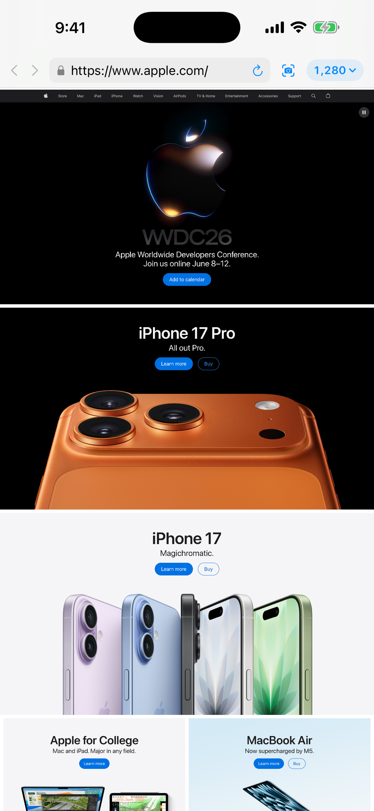
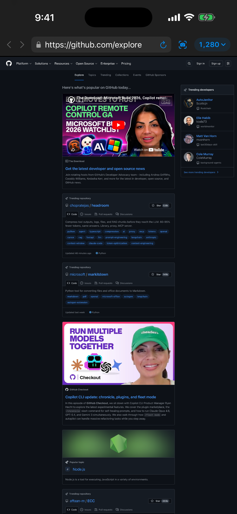
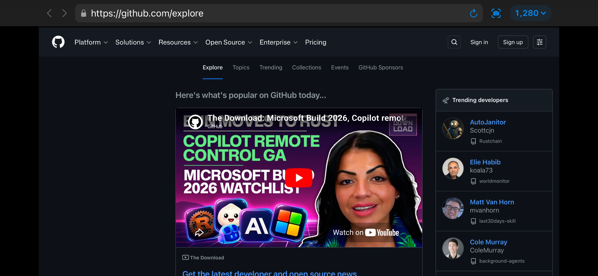
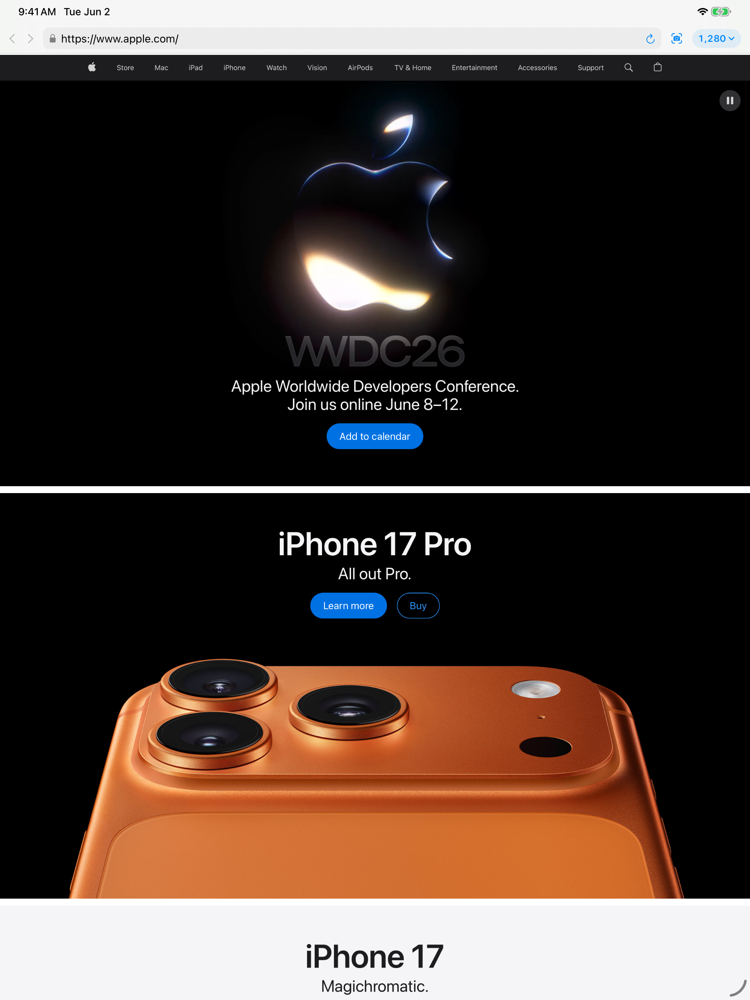
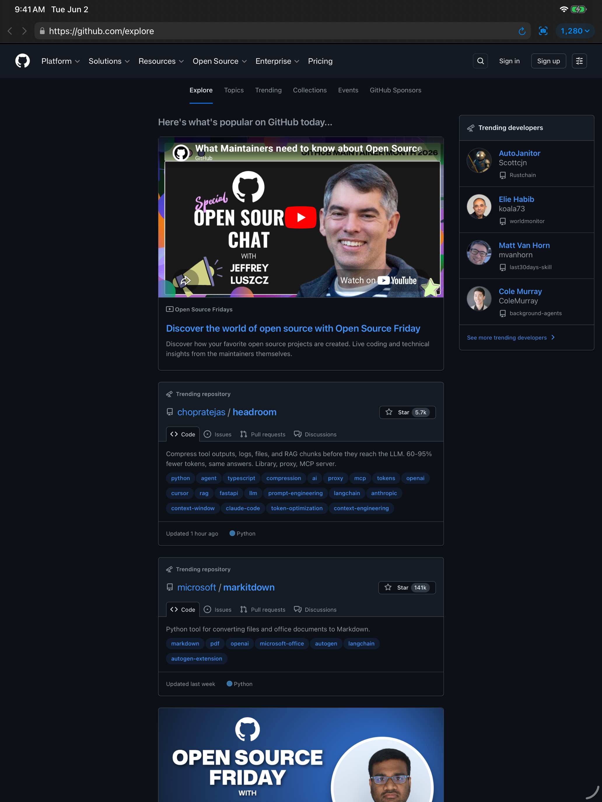

# Desktop Browser

**You shipped a desktop site. Your phone won't show it to you.**

Mobile Safari's "Request Desktop Site" only swaps the user agent — your
site still lays out at phone width. The desktop CSS you wrote never
evaluates; the features SaaS dashboards hide on mobile stay hidden.

Desktop Browser renders pages at a true desktop viewport (adjustable,
default 1280pt), scales them to fit your phone, and serves a real
desktop Safari user-agent. Same engine as Safari. The page sees a
desktop. You see the page.

<p align="center">
  
  
  
</p>

## Who it's for

- **Web developers** previewing their own site at desktop breakpoints
  from a phone, without walking back to a Mac
- Anyone who's hit "this feature is hidden on mobile" — Merge buttons
  on GitHub PRs, deploy logs on Vercel, transaction details on Stripe,
  admin panels on Notion, settings deep in Linear, dashboards on AWS
- Reading full desktop versions of articles, docs, and reference pages
  without the dumbed-down mobile layout
- Capturing full-page screenshots — entire scrollable canvas, not just
  the viewport

## Features

- **True desktop layout** — pages render at a fixed desktop width and are
  visually scaled to fit, combined with a desktop Safari user-agent and
  `.desktop` content mode
- **Adjustable resolution** — pick a preset (1024 / 1280 / 1440 / 1680 / 1920)
  or set any custom width up to 10000
- **One-tap full-page screenshot** — capture the entire scrollable page
  and share via Messages, Mail, AirDrop, or save to Photos
- **Long-press back/forward for full navigation history**
- **Safari-style URL bar** with tap-to-select-all
- **Light and dark mode**, portrait and landscape
- **Edge-swipe back/forward gestures**

## Privacy

No accounts, no ads, no tracking, no analytics, no servers. All browsing
happens locally via `WKWebView` — the same engine as Safari. See
[PRIVACY.md](PRIVACY.md).

## Build

Requires Xcode 17+ and [XcodeGen](https://github.com/yonom/XcodeGen).

```sh
brew install xcodegen      # if not already installed
xcodegen generate          # regenerates DesktopBrowser.xcodeproj from project.yml
open DesktopBrowser.xcodeproj
```

Or from the command line:

```sh
xcodegen generate
xcodebuild -project DesktopBrowser.xcodeproj -scheme DesktopBrowser \
  -destination 'platform=iOS Simulator,name=iPhone 17 Pro' build
```

## Project layout

| Path | Purpose |
|------|---------|
| `project.yml` | XcodeGen project spec (the `.xcodeproj` is generated, not committed) |
| `Sources/DesktopBrowserApp.swift` | App entry point |
| `Sources/BrowserModel.swift` | Owns the `WKWebView`, navigation state, desktop UA, and screenshot capture |
| `Sources/DesktopWebView.swift` | `UIViewRepresentable` that lays the web view out at desktop width and scales it to fit |
| `Sources/ContentView.swift` | Single combined toolbar with back/forward, URL, screenshot, and resolution |
| `Sources/URLField.swift` | `UITextField`-backed URL field for native gestures and Safari-style select-all |
| `Sources/ShareSheet.swift` | Native `UIActivityViewController` wrapper |
| `Resources/Assets.xcassets/` | App icon |
| `store/` | App Store metadata, copy, and screenshots |

## How desktop layout works

Two independent levers, both applied:

1. **User-agent + content mode** — a macOS Safari UA string and
   `preferredContentMode = .desktop` make servers send the desktop variant.
2. **Desktop-width rendering** — the web view is sized to the user's chosen
   desktop width (e.g. 1280pt) and a `CGAffineTransform` scales it down to
   the device width, so responsive CSS evaluates against a desktop-class
   viewport. See `DesktopWebView.ContainerView`.

## Screenshots (iPad)

<p align="center">
  
  
</p>

## License

MIT — see [LICENSE](LICENSE).

